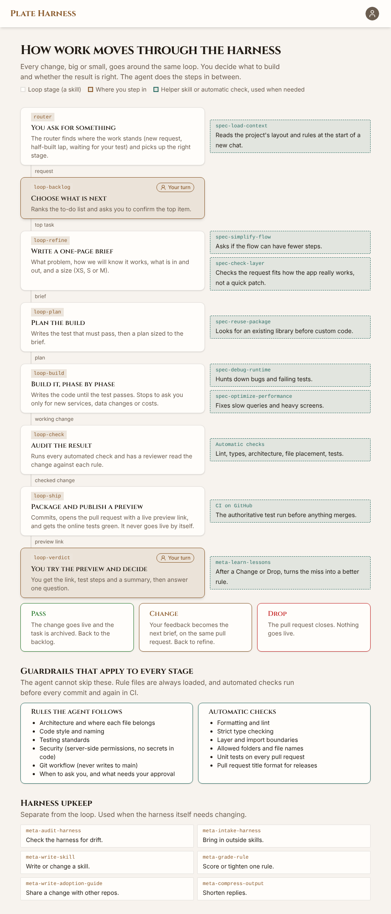

# plate-harness

A production-ready harness (boilerplate + agent harness) for building React applications with TypeScript, Vite, Tailwind CSS + shadcn/ui, and Supabase. It enforces strict architectural rules and includes authentication as an example feature.

[](public/harness-overview.png)

_How work moves through the agent harness, in plain language. The running app serves the same page at `/harness`._

## Features

- ⚡️ **Vite** - Fast build tool and dev server
- ⚛️ **React 19** - Latest React with TypeScript
- 🎨 **shadcn/ui** - Tailwind CSS v4 + Radix components owned in-repo (`src/components/common/`)
- 🗄️ **Supabase** - Backend-as-a-Service for authentication and database (optional)
- 🧭 **React Router** - Client-side routing
- 📏 **ESLint + GTS + Prettier** - Code quality and style enforcement (see [ARCHITECTURE.md](./ARCHITECTURE.md#code-quality-tools))
- 🧪 **Vitest** - Fast unit testing framework
- 🏗️ **Strict Architecture** - Enforced folder structure and import rules
- 🔒 **Authentication** - Complete auth flow (login, signup, logout) - requires Supabase

## Tech stack (pinned in `package.json`)

| Area | Version |
|------|---------|
| Runtime / UI | React 19, Tailwind CSS 4 + shadcn/ui (Radix, lucide-react), React Router 7 |
| Build | Vite 8, TypeScript 6 |
| Data | TanStack Query 5, Supabase JS 2 |
| Quality | ESLint 10, Vitest 4, Prettier 3, dependency-cruiser 17 |
| Agent onboarding | Root `AGENTS.md` (see [ARCHITECTURE.md](./ARCHITECTURE.md)) |

## Prerequisites

### Required

- **Node.js** 22.x or higher - [Download here](https://nodejs.org/)
- **pnpm** 9.15.4 or higher (recommended) or npm/yarn
  - Install globally: `npm install -g pnpm`
- **Git** - Required for cloning the repository and git hooks
  - [Download here](https://git-scm.com/downloads)

### Optional

- **Supabase Account** (optional) - [Sign up here](https://supabase.com) if you want to use authentication and database features
- **Graphviz** (optional) - Required only for generating architecture graph visualizations
  - Install: `choco install graphviz` (Windows with Chocolatey) or [download installer](https://graphviz.org/download/)
  - Only needed if you want to run `pnpm arch:graph` to visualize the architecture

### Linter Setup

This project uses **ESLint** and **Prettier** for code quality and formatting. The linters are already configured and will run automatically.

#### Verify Linter Installation

After running `pnpm install`, verify that the linters work correctly:

```bash
# Check for linting issues
pnpm lint

# Check if code formatting is correct
pnpm format:check
```

#### Common Linter Commands

- `pnpm lint` - Check for code quality issues (ESLint)
- `pnpm lint:fix` - Auto-fix ESLint errors
- `pnpm format` - Format all code with Prettier
- `pnpm format:check` - Check if code is formatted correctly

#### Editor Integration

**Recommended:** Configure VS Code/Cursor to:
- Format on save using Prettier
- Show ESLint errors in real-time
- Install the ESLint and Prettier extensions

**If you see many linting errors after cloning:**
- Run `pnpm format` to auto-fix formatting issues
- Run `pnpm lint:fix` to auto-fix linting issues

### Using Cursor Agent

**Requirement:** the agent can run `git add`, `git commit` and `git push` in your project; the loop commits for you once its checks pass.

If your editor's agent sandbox blocks git (on Windows this can show up as `env.exe: couldn't create signal pipe, Win32 error 5`), allow git commands for the agent in your editor's settings. Your agent can find the current setting for you.

## Quick Start Guide

This guide uses **Option B (fork + clone)** so your project starts in your own GitHub repo.

### Step 1: Fork this harness

1. Open this repository on GitHub.
2. Click **Fork**.
3. Create the fork under your account or organization.

### Step 2: Clone your fork and install dependencies

```bash
git clone https://github.com/<your-org-or-username>/<your-repo-name>.git
cd <your-repo-name>
pnpm install
```

**Note:** You may see TypeScript type errors in tooling output during setup. Vite still runs the app in development mode.

### Step 3: Set up branch workflow for this repo

Mode lives in `src/config/git-workflow.json`; what each mode does is the SSOT table in `.claude/rules/git-workflow.md` § Mode behavior table. The onboarding gates (`.agents/skills/loop-backlog/references/onboarding.md`) walk the setup.

| Mode | Daily work | Production | Config |
|------|------------|------------|--------|
| **Model C** (default — Claude Code defaults) | any branch (one per task / worktree session) → squash PR → `main` | you merge the PR | `"mode": "model-c"` |
| **Model A** (feature branches + `develop`) | `feature/*` → squash PR → `develop` | **Promote to production** (ff `main` ← `develop`) | `"mode": "model-a"` |
| **Model B** (direct `develop`) | commit/push on `develop` | **Promote to production** | `"mode": "model-b"` |

Every mode: agents never commit or push to `main` (a Claude Code hook enforces it).

**Model C:** no `develop`. Protect `main` (PR + required `test` and `pr-title` checks), set squash-only merges and allow auto-merge — see the table row **fork setup**.

**Model A / B:** create `develop` once:

```bash
git switch -c develop
git push -u origin develop
```

Model A then works on `feature/<name>` branches off `develop`; Model B stays on `develop`.

Optional (to pull future plate-harness updates):

```bash
git remote add upstream https://github.com/TMI-apps/plate-harness.git
git fetch upstream
```

### Step 4: Start the development server

```bash
pnpm dev
```

The app runs at `http://localhost:5173/` (or another port if 5173 is busy).

In local dev, use the floating **Tasks** button (bottom-right) to open `/tasks` — your onboarding checklist lives there.

### Step 5: Complete onboarding tasks

Easiest: tell your coding agent **"set up my app"**. It walks you through these one at a time: it connects the tools it works through, asks a few questions about your app, and gives you a link whenever something has to happen on a website.

Or work through the dev task backlog at `/tasks` yourself (or edit `src/config/app-tasks.json` directly). All sections are optional except what your app needs; configure what you want now and skip or archive the rest.

#### Supabase: sign-in and database (optional) 🔐

**You need:** a Supabase account and one project (the free plan is fine): [supabase.com/dashboard](https://supabase.com/dashboard)

**Done when:**

- [ ] `.env` in the project root holds your project's URL and **publishable** key (never the secret key; this one ends up in the browser):

  ```bash
  VITE_SUPABASE_URL=your-project-url
  VITE_SUPABASE_PUBLISHABLE_KEY=your-publishable-key
  ```

- [ ] The dev server was restarted after the change (`pnpm dev`)
- [ ] `/login` shows the sign-in panel and a sign-in works
- [ ] *Google sign-in, if you want it:* a Google OAuth client allows Supabase's callback URL. Requirements: [DOC_SUPABASE_GOOGLE_OAUTH.md](./documentation/DOC_SUPABASE_GOOGLE_OAUTH.md)

With the Supabase connector connected, your agent reads these values from your project itself; without it, the agent tells you which page shows them. (`VITE_SUPABASE_ANON_KEY` still works as the older name for the key.)

#### Put your app online: Cloudflare (optional) 🌐

**You need:** a Cloudflare account (the free plan is fine): [dash.cloudflare.com](https://dash.cloudflare.com)

**Done when:**

- [ ] Your GitHub repo is connected to Cloudflare Workers Builds, with `main` as the production branch and previews on for other branches
- [ ] A pull request gets a comment with its own preview link

Ask your agent to "do the hosting task"; it sets up the rest and checks it. Details: [DOC_CLOUDFLARE_WORKERS.md](./documentation/DOC_CLOUDFLARE_WORKERS.md)

#### Theme customization (optional) 🎨

Edit the design tokens in `src/shared/theme/tokens/` (W3C DTCG 2025.10 JSON: light and dark color files, a base file, a resolver), then run `pnpm tokens:build`. Radius, density, fonts, shadows and motion are tokens too, and `applyTheme()` restyles at runtime (e.g. per login). Users switch Light / Dark / System with the theme icon at the bottom of the profile menu. Guide: [documentation/DOC_THEMING.md](./documentation/DOC_THEMING.md).

#### App vision

Collaborate with your coding agent to fill [documentation/DOC_APP_VISION.md](./documentation/DOC_APP_VISION.md) and set status to **ACTIVE**.

### Step 6: Verify app routes

- Home: `http://localhost:5173/`
- Tasks (dev only, via FAB): `http://localhost:5173/tasks`
- Login (when Supabase configured): use ProfileMenu in the topbar

### Testing on a physical phone (optional)

Chrome DevTools device mode is enough for width breakpoints; it is **not** enough for mobile OAuth, viewport height, or keyboard issues. To test **local dev on a real device** (Android `adb reverse` + localhost, iOS tunnel/preview), follow [documentation/DOC_MOBILE_LOCAL_DEV.md](./documentation/DOC_MOBILE_LOCAL_DEV.md).

### You're ready

Start building per your git-workflow mode (`src/config/git-workflow.json`) — `.claude/rules/git-workflow.md` § Mode behavior table → **daily branch** and **production**.

## Installation

For detailed installation instructions, see the [Quick Start Guide](#quick-start-guide) above.

### Features

- ✅ **Authentication**: Supabase authentication (when configured)
- ✅ **Theme Customization**: Light/dark mode and W3C DTCG design tokens in `src/shared/theme/tokens/` ([guide](./documentation/DOC_THEMING.md))
- ✅ **Frontend Development**: All UI components and features work independently

### Configuring Supabase Later

The app runs without Supabase. Set it up anytime: ask your agent, or follow [Step 5 § Supabase](#supabase-sign-in-and-database-optional-).


### Troubleshooting

**Dev task backlog not visible?**
- `/tasks` is dev-only — use the floating button when running `pnpm dev`
- Production builds show an info message instead of the task list

**Supabase connection failing?**
- Verify your credentials are correct (check for typos)
- Ensure your `.env` file is in the project root (not in `src/`)
- Make sure you've restarted the dev server after creating `.env`
- Check that your Supabase project is active and not paused

**Environment variables not working?**
- Vite requires environment variables to start with `VITE_`
- Restart the dev server after changing `.env` file
- Don't commit `.env` to git (it should be in `.gitignore`)

**TypeScript errors during installation or when running `pnpm dev`?**
- TypeScript compilation errors are normal and won't prevent the app from running
- Vite handles TypeScript transpilation on the fly for the dev server
- These errors are typically related to type definitions in node_modules and can be ignored during development

## Scripts

- `pnpm dev` - Start development server
- `pnpm build` - Build for production
- `pnpm preview:worker` - Preview production build in Workers runtime (`pnpm build && wrangler dev`)
- `pnpm deploy` - Deploy to Cloudflare Workers (`wrangler deploy`)
- `pnpm lint` - Run ESLint (code quality checks)
- `pnpm lint:fix` - Auto-fix ESLint errors
- `pnpm format` - Format all code with Prettier
- `pnpm format:check` - Check if code is formatted correctly
- `pnpm type-check` - Run TypeScript type checking
- `pnpm test` - Run tests
- `pnpm test:ui` - Run tests with UI
- `pnpm test:coverage` - Run tests with coverage

### Code Quality Tools

This project uses **GTS**, **ESLint**, and **Prettier** together for code quality and formatting:

- **GTS** (Google TypeScript Style) - Provides pre-configured ESLint rules
- **ESLint** - Catches bugs and enforces code quality (with custom architecture rules)
- **Prettier** - Formats code automatically for consistency

**Quick Start:**
- Format code: `pnpm format`
- Check for issues: `pnpm lint`
- Auto-fix issues: `pnpm lint:fix`

**Editor Setup:**
- Configure your editor to format on save using Prettier
- ESLint will provide real-time feedback in your IDE
- See [ARCHITECTURE.md](./ARCHITECTURE.md#code-quality-tools) for detailed documentation

## Deployment (Cloudflare Workers Builds)

This starter targets **Cloudflare Workers** with static assets, deployed via **Workers Builds** (push-to-deploy). GitHub is the **CI/quality gate only** — it never deploys, and no `CLOUDFLARE_API_TOKEN` secret is needed.

- **GitHub:** runs `ci.yml`; rulesets per mode (table rows **`main` ruleset** / **`develop` ruleset**). Under Model C, `main` requires a PR plus green `test` and `pr-title` checks; release-please opens release PRs.
- **Cloudflare Workers Builds:** builds and deploys on push — `main` → production, every other branch → its own preview (Model A/B: `develop` is the stable staging preview).

To connect a fork:

1. Rename `name` in [`wrangler.jsonc`](./wrangler.jsonc).
2. In the Cloudflare dashboard, connect the repo (Build `pnpm install && pnpm run build`, Deploy `npx wrangler deploy`, Root directory **empty**).
3. Add build variables: `CLOUDFLARE_ACCOUNT_ID` and your `VITE_*` keys. Do **not** add `NODE_VERSION` — `.node-version` pins Node, and a dashboard `NODE_VERSION` silently overrides it (delete it if it exists).
4. Add the deployed origin to Supabase Auth URLs.

The template is **fork-safe**: no account id or custom domain is committed. Full checklist, Pages migration mapping, OAuth URLs, and troubleshooting: **[documentation/DOC_CLOUDFLARE_WORKERS.md](./documentation/DOC_CLOUDFLARE_WORKERS.md)**.

## Architecture

This project follows a strict feature-based architecture. See [ARCHITECTURE.md](./ARCHITECTURE.md) for detailed information about:

- Folder structure
- Code placement rules
- Dependency hierarchy
- Import patterns
- Code quality tools (GTS, ESLint, Prettier)

## Development Workflow

1. **Create a feature**: Add files in `src/features/[feature-name]/`
2. **Use common components**: Import from `@/components/common/...`
3. **Access shared code**: Import from `@/shared/...` or `@/features/...`
4. **Follow the layer rules**: Components → Hooks → Services
5. **Write tests**: Add tests alongside your code

## Project Structure

```
src/
├── assets/          # Static assets and global styles
├── components/      # App-level shared UI (Topbar, ProfileMenu, etc.)
│   └── common/
├── config/          # App config (e.g. dev task JSON)
├── features/        # Feature modules (auth, tasks, etc.)
│   ├── auth/
│   │   ├── components/
│   │   ├── hooks/
│   │   ├── services/
│   │   └── types/
│   └── tasks/
├── layouts/         # Layout components
├── pages/           # Route-level page components (subfolder per page)
├── routes/          # Router config and guards
└── shared/          # Cross-feature utilities, services, theme, context
    ├── context/
    ├── hooks/
    ├── services/
    ├── theme/
    └── utils/
```

## Testing

See **[documentation/DOC_TESTING.md](./documentation/DOC_TESTING.md)** for runners, file placement, naming, shared utilities, and examples.

Tests use Vitest and React Testing Library. Example tests are included for:
- Service functions (unit tests)
- React components (component tests)

Run tests:
```bash
pnpm test
pnpm test:classify   # classifier + executor unit tests
pnpm test:run        # full Vitest suite (CI merge gate)
pnpm test:staged     # dry-run — preview pre-commit test mode + paths
pnpm test:staged:live # run the same tests as pre-commit without committing
```

## CI/CD

GitHub Actions workflow runs on every push/PR:
- Type checking
- Linting
- Format checking
- Tests
- Build verification

## Contributing

See [documentation/DOC_CONTRIBUTING.md](./documentation/DOC_CONTRIBUTING.md) for how to contribute safely. Key points:

1. **Workflow & versioning** – Use [`.agents/skills/loop-ship/SKILL.md`](./.agents/skills/loop-ship/SKILL.md) before committing
2. **Architecture** – Follow [`.claude/rules/architecture.md`](./.claude/rules/architecture.md)
3. **Documentation index** – [documentation/DOC_INDEX.md](./documentation/DOC_INDEX.md) for all docs
4. Ensure all checks pass (`pnpm lint`, `pnpm format:check`, `pnpm test:classify`, `pnpm test:run`, `pnpm validate:version-sync`)
5. Update CHANGELOG.md for significant changes

